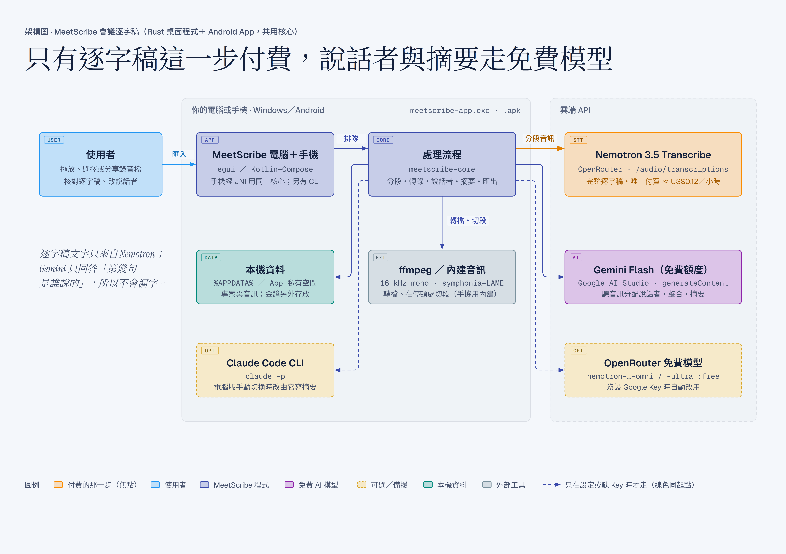
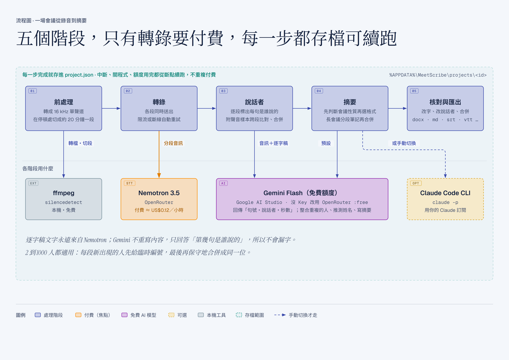

# 語音轉錄

會議錄音（或影片）→ **完整逐字稿（標出誰說的）＋ 依內容決定格式的會議摘要**。Windows 桌面程式與 **Android App**，核心以 Rust 寫成、兩邊共用；裝好之後**會自己更新**。
（1.1 起改名「語音轉錄」；程式內部、資料夾與安裝檔名仍叫 MeetScribe，舊版可直接升級。）

| 工作 | 預設用什麼 | 費用 |
|---|---|---|
| 逐字稿 | OpenRouter 上的 NVIDIA **Nemotron 3.5 Transcribe** | 付費，約 US$0.12／小時音訊 |
| 誰在說話 | Google AI Studio 的 **Gemini Flash 免費額度**（聽音訊判斷） | 免費 |
| 會議摘要 | 同上，Gemini 免費額度 | 免費 |
| 摘要（可選） | 你電腦上的 **Claude Code CLI**（`claude -p`，用你的 Claude 訂閱） | — |

沒設定 Google Key 時，說話者與摘要會自動改用 OpenRouter 上的免費模型（`nvidia/nemotron-3-nano-omni-30b-a3b-reasoning:free`、`nvidia/nemotron-3-ultra-550b-a55b:free`），一樣不花錢。

## 架構一覽

| 執行架構圖 | 處理流程圖 |
|---|---|
|  |  |

A2 橫式 300 DPI；同名向量 PDF 在 `docs/架構圖/PDF/`，原始檔在 `docs/架構圖/HTML/`。

## 安裝

到 [Releases](https://github.com/win81134679-dot/meetscribe/releases) 下載 **`MeetScribe-Setup-v<版本>.exe`** 執行：

- 只裝給目前的 Windows 帳號（`%LOCALAPPDATA%\Programs\MeetScribe`），不需要系統管理員。
- 開始功能表會有「語音轉錄」，安裝時可勾選在桌面也建一個。
- 電腦上找不到 ffmpeg 時，最後一頁會多一個「安裝 ffmpeg」的勾選（用 winget 下載，約 100 MB）。
- 程式沒有數位簽章，第一次執行 Windows 可能跳出「Windows 已保護您的電腦」：按「其他資訊」→「仍要執行」。
- 解除安裝在「設定 → 應用程式」。會議資料（`%APPDATA%\MeetScribe`）與金鑰（Windows 認證管理員）會保留，重新安裝後還在。

- 之後的新版會**自動更新**，不用再下載安裝檔（見〈自動更新〉）。

自己從原始碼建安裝程式：先關掉語音轉錄，再跑 `powershell -ExecutionPolicy Bypass -File installer\build-installer.ps1`
（需要 Rust 與 [Inno Setup 6](https://jrsoftware.org/isinfo.php)，產出在 `dist\`）。

## 需要準備

1. **ffmpeg**：安裝程式會幫你裝；自己裝用 `winget install Gyan.FFmpeg`（程式會自己找；找不到可在設定指定位置）。
2. **OpenRouter 帳戶**（必要，逐字稿用）：[儲值](https://openrouter.ai/settings/credits)、[建立 API Key](https://openrouter.ai/settings/keys)。程式的「新增轉錄」頁有按鈕直接帶你去。
3. **Google AI Studio API Key**（建議，免費）：<https://aistudio.google.com/apikey>。
4. **Claude Code**（選用）：要用它寫摘要時，先在終端機登入過一次 `claude`。

金鑰在「設定」頁貼上即可，存在 **Windows 認證管理員**，不會寫進任何設定檔。

## 使用

1. 從開始功能表開「語音轉錄」；用原始碼的話雙擊專案資料夾裡的 **`開啟 語音轉錄.cmd`**（或直接開 `target\release\meetscribe-app.exe`）。程式一律從「新增轉錄」頁開始，視窗開在螢幕正中間（螢幕比較小時會自動縮到放得下）。
   想放到桌面：在 `target\release\meetscribe-app.exe` 上按右鍵 →「傳送到」→「桌面（建立捷徑）」。
2. 第一次使用，「新增轉錄」頁最上面會有三個步驟，照著按就好：
   ① **開啟 OpenRouter 儲值頁**儲值（頁面會顯示儲值 US$5 約可轉幾小時）→
   ② **開啟 OpenRouter API Keys 頁**建立金鑰 → ③ 把 `sk-or-…` 貼進框裡按「儲存」，程式會自動測試並顯示餘額。
   下方「選用：Gemini 免費金鑰」可以順便設定（不設也能用）。
   設定好之後這塊會縮成一列：顯示 OpenRouter 餘額，右邊隨時有「儲值」「API Keys」按鈕。
3. 把錄音檔拖進視窗（可一次多個，會依序處理）。
   - 有與會者名單就貼上（一行一位），模型比較能把「說話者 1」對上真名。
   - 專有名詞（人名、產品代號）填進去可提升辨識率。
   - 「摘要方式」可在這裡切成「本機 Claude Code CLI」。
   - 「輸出」：完成後自動匯出成哪些格式、存到哪裡（預設 Word＋Markdown＋SRT，放在錄音檔旁邊、**每場會議一個子資料夾**）。這裡改的會記成下次的預設。
4. 處理中可以看進度、取消；中斷（關程式、斷網、額度用完）後按「從中斷處繼續」，已完成的段落不會重做、不會重複付費。
5. 完成後：
   - **摘要**：格式由模型依會議性質決定（決策會議列決議與待辦、講座整理重點、訪談整理問答…）；可加額外要求重新產生、可直接編輯。
   - **逐字稿**：點時間從那裡播放；點說話者改成別人；點文字修改、合併上一句、刪除。搜尋、依說話者篩選、跟隨播放。
     播放的是高品質音訊（AAC 128 kbps），不是送去轉錄的 16 kHz 版本。
   - **說話者**：改名（標「推測」的是模型判斷的，請核對）、把被拆開的同一人合併、聽聲音樣本、重新辨識。
   - **匯出**：處理完成就依「輸出」選項自動匯出；改了逐字稿或說話者之後，到「匯出」頁再匯出一次。
6. 處理完成時如果視窗不在前面，工作列上的圖示會閃一下提醒你。

## Android 版

到 [Releases](https://github.com/win81134679-dot/meetscribe/releases) 下載 **`MeetScribe-Android-v<版本>.apk`**（自己建置的在 `dist\`）。
複製到手機（LINE 傳給自己、雲端硬碟、USB 都可以）後開啟安裝
（第一次會問「允許安裝不明來源的應用程式」，對下載它的 App 允許一次即可）。需要 Android 8.0 以上、64 位元 ARM 手機（近年的手機都是）。

用法跟電腦版相同：開啟後在「新增轉錄」照三步驟設定 OpenRouter → 「開始錄音」或「選擇錄音檔」→「開始轉錄」。另外可以：

- **現場錄音**：按「開始錄音」，手機就是錄音機；可暫停／繼續，關螢幕、切到別的 App 都會繼續錄。按「停止並使用」就直接當成這次要轉錄的檔。
- 在錄音機、LINE 等 App 對錄音按「分享」或「開啟方式」→ 選語音轉錄，直接帶進新增轉錄。
- 處理時可以切到別的 App 或關螢幕：通知列會顯示進度，做完會通知「處理完成」，點通知直接打開那場會議。被系統中斷就到該場會議按「從中斷處續跑」。
- 匯出檔存在手機的 **「文件／語音轉錄／<會議名稱>」**（每場會議一個資料夾）：系統的「檔案」App 看得到，接電腦時在 `Documents\語音轉錄`。
  會議的「匯出」分頁按 **「開啟資料夾」** 直接打開那個資料夾；也能「分享」存到雲端硬碟、傳 LINE 或寄信，按 ↗ 用其他 App 開啟。
- 逐字稿可以**搜尋**（反白、顯示幾段符合）、一鍵**複製全文**；摘要可以複製；會議多了清單上方會出現搜尋框。
- 刪除會議時會問要不要**一併刪掉已匯出到手機的檔案**（列出幾個檔、在哪個資料夾，預設勾選）；只刪本程式產生的匯出檔，資料夾空了一起刪。

跟電腦版的差異：

| | 電腦版 | Android 版 |
|---|---|---|
| 音訊處理 | ffmpeg | 內建（不用另外裝）；Opus、AMR 等格式由手機系統解碼 |
| 金鑰存放 | Windows 認證管理員 | App 私有空間（其他 App 讀不到，解除安裝就清掉） |
| 摘要改用本機 Claude Code CLI | 可 | 無（手機沒有） |
| 自訂提示詞 | `%APPDATA%\MeetScribe\prompts\` | 用內建提示詞 |
| 一次匯入多個檔 | 可（拖進視窗） | 一次一個 |
| 現場錄音 | 無 | 可（App 內錄音） |
| 匯出位置 | 預設錄音檔旁邊 | 「文件／語音轉錄」 |
| 更新 | 背景下載、關閉程式時自動安裝 | 背景下載、按一下「更新」安裝 |

會議資料不會在電腦與手機之間同步；兩邊各自需要設定金鑰。

## 自動更新

新版發佈在本 repo 的 [Releases](https://github.com/win81134679-dot/meetscribe/releases)，已安裝的程式每天自己檢查一次：

- **電腦版**：背景下載好後，側欄頂端出現「新版已備妥」。可以按「立即更新」（裝完自動重新開啟），或什麼都不做——**下次關閉程式時會自動安裝**。
- **手機版**：背景下載好後會通知，「新增轉錄」頂端與「設定」出現「更新」按鈕，按一下就安裝。Android 規定商店以外的 App 不能完全不經同意就安裝，
  所以第一次會帶你到系統設定「允許安裝不明應用程式」；Android 12 以上之後的更新通常不再跳確認。
- 「設定 → 關於與更新」可以關掉自動更新、手動「檢查更新」，也看得到這台的**本機識別碼**（`XXXX-XXXX`）。
- 每台裝置有自己的識別碼，發佈者可以只推送給指定的裝置（先給一兩台試，沒問題再開放給所有人）。
- 每個新版都有數位簽章，程式只安裝簽章對得上的檔案；從開發中的 `target\` 執行的那份只檢查、不自動安裝。

發佈新版（發佈者用）：

```powershell
uv run 工具/publish.py publish --notes "這版改了什麼"                 # 給所有裝置
uv run 工具/publish.py publish --notes "…" --devices K7Q2-9XMA,王老師   # 只給這些裝置（名字對照放 工具/devices.json）
uv run 工具/publish.py open v1.2.0                                  # 試完了，開放給所有裝置
```

它會找 `dist\` 裡這一版的安裝檔與 APK、簽好 `update.json`，建立 GitHub Release。簽章私鑰在 `keys\`（不進版控）：
**遺失就再也推送不了更新**（已安裝的只能手動重裝），一定要另外備份。

## 輸出選項

在「設定 → 輸出」設預設值，「新增轉錄」可以只改那一次，每場會議的「匯出」頁可以換別的組合再匯出。

| 選項 | 內容 |
|---|---|
| 格式 | Word、Markdown、純文字、SRT／WebVTT 字幕、CSV（Excel）、JSON，可複選 |
| Word 版面 | A4 會議紀錄：標題區與會議資訊表、摘要（條列、待辦方框、表格）、發言者表（顏色、佔比）、逐字稿另起一頁（說話者顏色＋時間）、頁首會議名稱、頁尾頁碼 |
| 存到 | 原始錄音所在的資料夾，或指定資料夾；預設**每場會議另建一個資料夾**（可關） |
| 檔名 | 樣式可用 `{標題}`、`{日期}`、`{時間}`，例如 `{日期} {標題}` → `2026-10-31 產品週會.docx` |
| 內容 | Word／Markdown／純文字：摘要＋逐字稿同一個檔、分成「摘要」「逐字稿」兩個檔、只要逐字稿、只要摘要 |
| 逐字稿樣式 | 時間戳、說話者名稱、同一人連續發言併成一段、開頭附檔案資訊與發言者統計（各自可關） |
| 同名檔案 | 另存成「名稱 (2)」（預設），或直接覆蓋 |
| 自動匯出 | 處理完成後自動匯出；已完成的會議再按一次續跑、內容沒變時不會重複匯出 |

## 大型會議（2～1000 人）怎麼處理

- 錄音超過 10 分鐘（可調）會在**停頓處**切段，長度不限。
- 轉錄服務忙碌時（錯誤 504／524，這種失敗不收費），程式會自動改成一段一段、間隔一下再重送，不用手動處理；連續 6 輪都忙才會停下來，之後按「從中斷處繼續」即可。
- 說話者辨識一段最多等 3 分鐘、不行就換下一段；連續 3 段辨識不出來就先不標說話者、把逐字稿做完（之後可在會議頁「重新辨識說話者」），不會卡住整場。
- 每段的說話者由 Gemini 聽音訊判斷；前面段落出現過的人會附上**聲音樣本**給下一段比對，讓同一人跨段保持同一個標籤。
- 全部完成後再做一次「整合」：看每位說話者的描述與發言，**保守地**合併重複的人、推測姓名。
- 逐字稿文字永遠以 Nemotron 的辨識結果為準；說話者模型只回「第幾句是誰」，所以不會因為它偷懶而漏字。
- 人非常多時，自動辨識難免把同一人拆成兩位或把聲音相近的人併在一起，請在「說話者」頁核對。

## 命令列（批次、自動化）

```powershell
meetscribe-cli transcribe 會議.m4a --participants 名單.txt --keyterms "語音轉錄,Nemotron" --formats md,docx,srt
meetscribe-cli transcribe *.mp3 --summary claude      # 摘要改用本機 Claude Code CLI
meetscribe-cli list
meetscribe-cli resume 1a2b3c4d                         # 從中斷處繼續
meetscribe-cli summarize 1a2b3c4d --instructions "列出每位主管的意見"
meetscribe-cli export 1a2b3c4d --formats docx --out D:\會議記錄
```

`--formats`、`--out` 只蓋過格式與資料夾，其餘（檔名樣式、內容、逐字稿樣式）用設定頁的「輸出」。

設定、金鑰、專案都跟桌面程式共用。也可以用環境變數 `OPENROUTER_API_KEY`、`GEMINI_API_KEY` 給金鑰。

## 資料放在哪

`%APPDATA%\MeetScribe\`（可用環境變數 `MEETSCRIBE_HOME` 改到別處，例如隨身碟）：

| 位置 | 內容 |
|---|---|
| `settings.json` | 設定（不含金鑰） |
| `projects\<ID>\project.json` | 逐字稿、說話者、摘要、費用 |
| `projects\<ID>\audio.mp3`、`chunks\`、`clips\` | 送轉錄用的 16 kHz 音訊、分段、聲音樣本 |
| `projects\<ID>\playback.m4a` | 播放用的高品質音訊（AAC；手機版是原始錄音） |
| `prompts\` | 自訂提示詞（設定頁「自訂提示詞…」會放範本與說明） |
| `logs\meetscribe.log` | 執行紀錄 |
| `device-id.txt`、`update-state.json`、`updates\` | 本機識別碼、更新狀態、下載好的新版安裝檔 |

## 隱私

- 錄音會上傳到 OpenRouter（及其供應商 DeepInfra）轉錄；說話者與摘要會送到 Google 或 OpenRouter 的免費模型。
- **Google 免費方案的輸入可能被 Google 用來改善產品**，免費模型供應商也可能記錄內容。機密會議請：摘要改用本機 Claude Code CLI、在設定勾選「OpenRouter 只路由到不保留資料的供應商」，或改用付費方案。

## 從原始碼建置

```powershell
cargo build --release          # 產出 target\release\meetscribe-app.exe、meetscribe-cli.exe
cargo test --workspace         # 單元＋端對端（需 ffmpeg）＋離屏 UI 渲染
cargo test -p meetscribe-core --test claude_cli_live -- --ignored   # 實際呼叫本機 Claude Code
cargo test -p meetscribe-core -p meetscribe-android --features meetscribe-core/native-audio   # Android 用的音訊後端與 JNI 橋（在電腦上跑）
```

### Android APK

需要：Android Studio（用它附的 JDK）、Android SDK 的 **NDK 28.2**、platform 37／build-tools 36、rustup 的 `aarch64-linux-android` target。

```powershell
powershell -ExecutionPolicy Bypass -File android\build-apk.ps1            # 正式版 → dist\MeetScribe-Android-v<版本>.apk
powershell -ExecutionPolicy Bypass -File android\build-apk.ps1 -Debug -Abis arm64-v8a,x86_64   # 給電腦上的模擬器測試
```

正式版要簽章金鑰 `android\keystore\meetscribe-release.jks` 與密碼檔 `android\keystore.properties`（都不進版控）。
**這兩個檔一定要另外備份**：遺失之後就不能再發佈「同一個 App」的更新（使用者得先解除安裝才能裝新版）。
沒有的話用 JDK 的 `keytool -genkeypair -keystore android\keystore\meetscribe-release.jks -alias meetscribe -keyalg RSA -keysize 4096 -validity 36500`
產生，再照 `android\app\build.gradle.kts` 開頭的欄位寫 `keystore.properties`。

架構與擴充方式見 `CLAUDE.md`，設計決定與進度見 `PLAN.md`。

## 授權

本專案以 [MIT 授權](LICENSE) 釋出，可自由使用、修改、散布（含商業用途），保留著作權與授權聲明即可。

例外：`third_party/mp3lame-sys/` 內含的 LAME MP3 編碼器是 **LGPL-3.0**（見該資料夾的 `LICENSE`、`lame-3.100/COPYING`），Android 版用它編 MP3；
它以獨立函式庫的形式使用，修改它的部分要依 LGPL 公開。其他相依套件依各自的授權（多為 MIT／Apache-2.0）。
